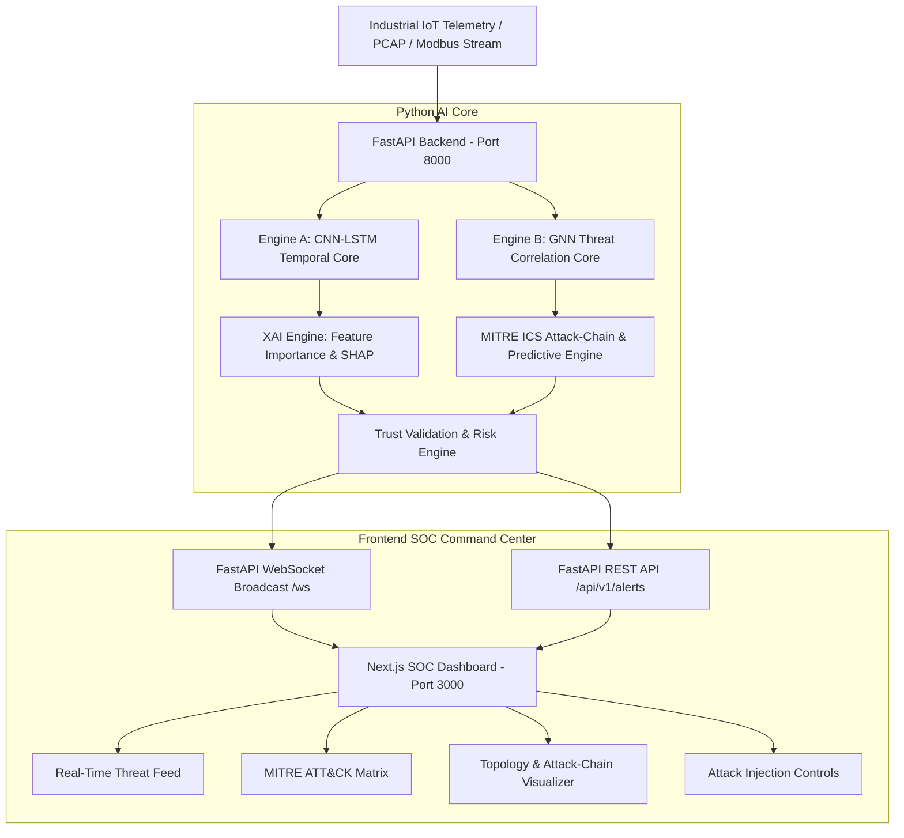

# NEUROSHIELD: PROJECT ROADMAP & ARCHITECTURE SPECIFICATION

> **Official Project Title:**  
> *NeuroShield: A Dual-Core Explainable AI Framework for Real-Time Attack Detection, Attack-Chain Correlation and Predictive Threat Analysis in Industrial IoT (IIoT) and Smart Manufacturing (IT-OT) Environments*

---

## 📌 Context For AI Assistants
If you are an AI assistant opening this project in a new session:
- **Do not treat this as a simple mock or demo project.** The goal is a production-grade, genuine **Dual-Core Explainable AI** system.
- **Do not delete or bypass the Python backend.** The Python backend is the primary AI brain (CNN-LSTM + GNN + XAI + Industrial Protocol processing).
- **The Next.js app in `/neuroshield` is the primary SOC Dashboard.** It must be wired to stream live data from the Python backend via WebSockets / REST.

---

## 🏗️ System Architecture



---

## 🔍 Current Repository State (Audit as of October 2026)

| Component | Path | Current Status | Target State |
| :--- | :--- | :--- | :--- |
| **SOC Dashboard** | `d:/B.E Final/neuroshield` | ✅ Next.js 16 UI built, but currently uses `Math.random()` simulation in `lib/pipeline.ts`. | Connect to `ws://localhost:8000/ws` and render real live telemetry from Python. |
| **Python API** | `d:/B.E Final/backend/main.py` | ⚠️ FastAPI server with WebSocket manager exists, but needs real payload handlers. | Full real-time ingestion, attack trigger routes, and WebSocket streaming. |
| **Engine A (CNN-LSTM)** | `d:/B.E Final/backend/ai_pipeline.py` | ❌ 4-line placeholder returning mock dictionary. | Real sequence modeling on packet statistics (flow rate, length variance, SYN/ACK ratios). |
| **Engine B (GNN Correlation)** | `d:/B.E Final/backend/ai_pipeline.py` | ❌ 4-line placeholder returning mock dictionary. | Real IT-OT graph topology (PLC $\leftrightarrow$ SCADA $\leftrightarrow$ HMI) with MITRE ICS transition probabilities. |
| **Explainable AI (XAI)** | `d:/B.E Final/backend/ai_pipeline.py` | ❌ Hardcoded dummy feature weights. | Perturbation/attribution algorithm showing exact features causing the detection. |
| **Trust Score Engine** | `d:/B.E Final/backend/ai_pipeline.py` | ❌ Random integer 75-99. | Sensitivity & confidence scoring to minimize false positives. |

---

## 🚀 Step-by-Step Implementation Plan

### Phase 1: Real AI Engine Implementation (`backend/ai_pipeline.py`)
1. **Engine A (Temporal Packet Sequence Analyzer):**
   - Implement sliding-window sequence analysis over packet arrival time, packet size, byte ratios, and TCP flags.
   - Compute anomaly scores indicating DoS, Port Scans, and Brute Force attacks.
2. **Engine B (Graph Threat Correlator):**
   - Construct an IT-OT asset graph:
     - `SCADA-Master` (Level 2 Supervisory)
     - `PLC-001`, `PLC-002` (Level 1 Control)
     - `HMI-01` (Human-Machine Interface)
     - `RTU-01`, `Gateway-Edge` (Field Devices & Telemetry)
   - Map alerts to **MITRE ATT&CK for ICS** tactics:
     - `T1190` Exploit Public-Facing Application
     - `T1078` Valid Accounts / Unauthorized Access
     - `T1021` Remote Services / Lateral Movement
     - `T0855` Unauthorized Command Message (ICS Impairment)
     - `T0831` Manipulation of Control
   - Implement multi-stage Markov / GNN transition matrix to predict the **Next Probable Attack Stage**.
3. **Explainable AI (XAI):**
   - Calculate exact feature attributions showing operators *which* telemetry values triggered the threshold.
4. **Trust Validation:**
   - Stability score evaluating noise variance to confirm high-confidence alerts.

### Phase 2: Attack Injection & Simulation Suite (`backend/main.py`)
Add endpoints to trigger real attack scenarios on demand:
- `POST /api/v1/simulate/modbus_injection`: Simulates rogue PLC command override.
- `POST /api/v1/simulate/ddos_scada`: Simulates high-rate traffic flooding SCADA master.
- `POST /api/v1/simulate/lateral_movement`: Simulates compromised HMI jumping to field PLCs.

### Phase 3: Wire Next.js SOC to Python Backend (`neuroshield`)
1. Update `neuroshield/src/app/page.tsx`:
   - Replace internal `fetch('/api/alerts')` with `new WebSocket('ws://localhost:8000/ws')` (with automatic fallback to REST).
2. Wire real-time state into:
   - Live Threat Feed
   - Criticality Pie & Severity Trend Charts
   - MITRE ATT&CK active path indicator
   - Attack trigger buttons in the UI

---

## 🛠️ How To Run The Complete Project

### 1. Start Python AI Backend:
```powershell
cd "d:\B.E Final\backend"
# Activate venv if available
.\venv\Scripts\Activate.ps1
# Run FastAPI server
uvicorn main:app --reload --port 8000
```
*API docs will be available at:* `http://localhost:8000/docs`

### 2. Start Next.js SOC Dashboard:
```powershell
cd "d:\B.E Final\neuroshield"
npm run dev
```
*Dashboard will be available at:* `http://localhost:3000`

---

## 📦 Git & GitHub Strategy
- **Repository Root:** `d:\B.E Final` (tracks `backend`, `neuroshield`, and documentation).
- **Vercel Deployment:** When deploying the Next.js frontend to Vercel, set the **Root Directory** setting to `neuroshield`.
- **Backend Deployment:** Python FastAPI can be hosted on **Render**, **Railway**, or run locally for live demonstration.
